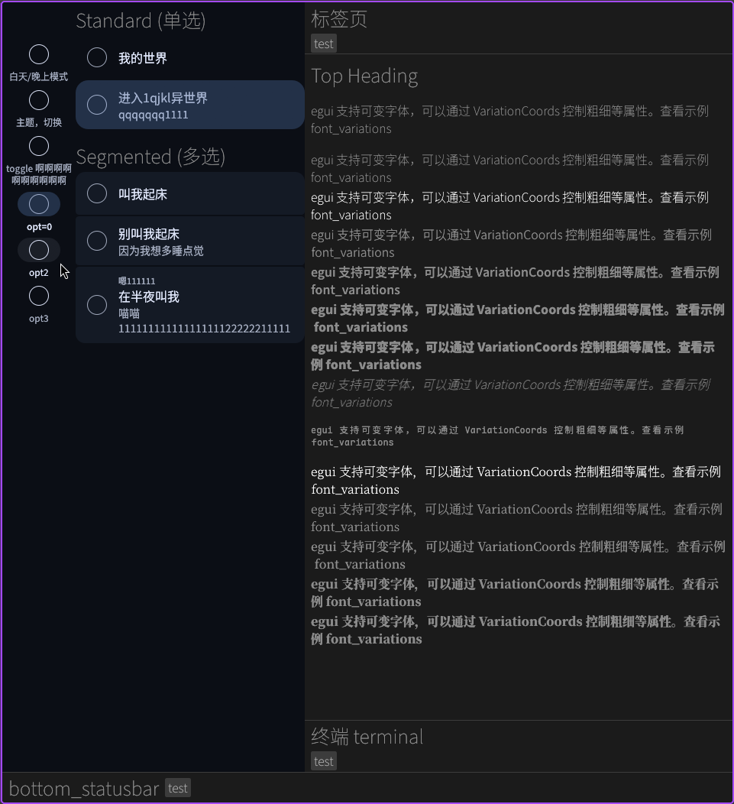

# hnfm-egui-test

egui 自定义 Material 3 组件测试代码，未来会移植到[另一项目](https://github.com/sb-child/HoshinekoFM)。

运行 [`download_fonts.py`](./download_fonts.py) 下载字体 (没写 `build.rs`)

## 状态

正在从纯 Material 3 迁移到 [`dux-qml-common`](https://github.com/duxlabs-dev/dux-qml-common) 的实现。组件契约和反魔法自查见 [AGENTS.md](./AGENTS.md)。

## todo list

- 字体([src/fonts/](./src/fonts/)): 但是没有用 Roboto
- 颜色([src/material/color.rs](./src/material/color.rs)): 能用
- 图标 [Material Symbols](https://m3.material.io/styles/icons/overview): todo
- [Buttons](https://m3.material.io/components/buttons/specs): 能用
- [Cards](https://m3.material.io/components/cards/specs): 能用
- Spinner: 能用
- [Tooltips](https://m3.material.io/components/tooltips/specs): 能用（纯文本 plain tooltip）
- [Navigation Rail](https://m3.material.io/components/navigation-rail/specs): todo
- [Lists](https://m3.material.io/components/lists/specs): todo

## 参考

- 实现参考：[`duxlabs-dev/dux-qml-common`](https://github.com/duxlabs-dev/dux-qml-common) @ `c6e4a6b`
  - 组件：`DCommon/Widgets/`
  - 样式：`DCommon/Common/Style.qml`
  - 形状：`DCommon/Common/Shape.js`、`SHAPES.md`
  - 应用入口：[`dux-shell/quickshell`](https://github.com/duxlabs-dev/dux-shell/tree/master/quickshell)
- 设计规范：[Material 3](https://m3.material.io/components)、[AndroidX Compose Material3](https://github.com/androidx/androidx/tree/androidx-main/compose/material3)

## 致谢

- `gemini` 提供了一些 UI/UX 建议
- `deepseek v4 pro`, `glm 5.1`, `mimo v2.5 pro` 陪我写

## License

MIT
